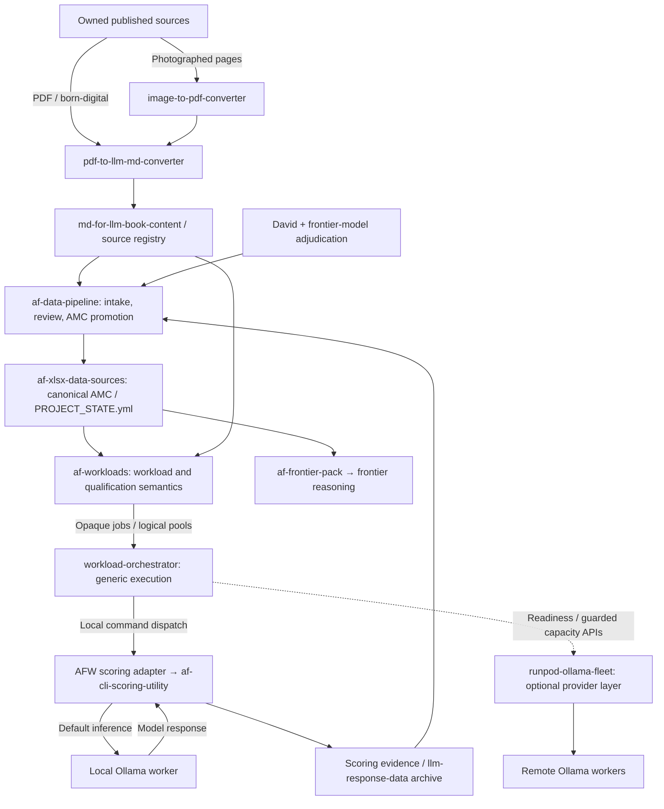

# AdventureFinder

The **workspace/front-door repository** for the AdventureFinder polyrepo project.

AdventureFinder's north star is to build the best possible artifact for David +
frontier ChatGPT to reason about and explore David's TTRPG adventure library. This
repository does not own that artifact's canonical truth. It makes the repositories
that *do* own it easier to understand, clone, inspect, synchronize, test, and reproduce.

## What this repository owns

Only cross-repository concerns:

- the map of AdventureFinder repositories and their responsibilities;
- safe multi-repo bootstrap/status/sync/test commands;
- lightweight environment/integrity checks;
- optional workspace commit snapshots; and
- future tests for genuinely cross-repository contracts.

It deliberately contains **no copied AMC workbook, book corpus, scoring semantics,
matching semantics, or model evidence**.

## Historical milestones

**AMC 6.0 — September 19, 2026.** AMC 6.0 marks completion of the established
13-column production-scoring baseline across all 879 Adventure Catalog records.
The frozen cross-repository and artifact snapshot is recorded in
[`milestones/amc-6.0.yml`](milestones/amc-6.0.yml).

This is historical context only. Live catalog roles remain authoritative in
`af-xlsx-data-sources/PROJECT_STATE.yml`.

## Quick start

For production operation, start with the
[composed operator runbook](docs/operator-runbook.md). It resolves short handles
and calls component-owned public interfaces for execution, capacity and review.

The front door stays outside the non-Git component container. For a new installation:

```bash
export AF_PROJECT_ROOT=/Users/davidnorris/code/adventure-finder-components
export AF_ADVENTURE_FINDER_ROOT=/Users/davidnorris/code/adventure-finder
cd /Users/davidnorris/code
git clone git@github.com:dtnorris/adventure-finder.git
cd "$AF_ADVENTURE_FINDER_ROOT"

bin/af-doctor
bin/af-bootstrap
bin/af-status
bin/af-test
```

For a brand-new machine, clone and run each repository's lightweight setup command:

```bash
bin/af-bootstrap --setup
bin/af-doctor
bin/af-test
```

`--setup` delegates dependency installation to each repository's own setup command.
For mixed Ruby/Python converters, that includes creating or reusing a repository-local
`.venv` and installing the component-owned Python dependencies there. It intentionally
does **not** install Homebrew/system packages, download model assets, create cloud
resources, or run inference.

If HTTPS cloning is preferred:

```bash
AF_GIT_PROTOCOL=https bin/af-bootstrap
```

Override the normal workspace root:

```bash
AF_PROJECT_ROOT=/another/path bin/af-status
```

## Filesystem roots

`AF_PROJECT_ROOT` (and operator `--root`) is the component parent, defaulting to
`/Users/davidnorris/code/adventure-finder-components`. This container is not a Git
repository. Normal components and the four retained production checkouts share it;
production names remain explicit `-production` identities in the operator registry.
No production twins are created automatically. The intended production front door
is `/Users/davidnorris/code/adventure-finder-production`, also outside the container.
Test timing output belongs to the front door actually running `af-test`.

Existing flat installations remain supported by explicitly selecting
`AF_PROJECT_ROOT=/Users/davidnorris/code`; there is no existence-based fallback to
old paths. `AF_PDF_CONVERTER_ROOT` and `AF_DATA_PIPELINE_ROOT` override catalog
component routing. Catalog ingestion passes the selected front door through
`AF_ADVENTURE_FINDER_ROOT`. The PDF converter already supports that override;
Frontier must receive `AF_PROJECT_ROOT` explicitly.

For new production ingestion, deliberately set both `AF_AFW_ROOT` and
`AF_SCORER_ROOT` to their retained production checkouts. Their defaults select
normal `af-workloads` and `af-cli-scoring-utility`, never legacy AFIO. This does not
upgrade frozen production commits/configuration or migrate retained execution state.

The three archived/experimental entries remain opt-in with `--all` and live outside
the component container, beside the front door. `--adjacent-root` or
`AF_ADJACENT_ROOT` explicitly selects a different outside parent. Legacy
`af-inference-orchestrator-production` remains HOLD outside, unmanaged by this list.

## Commands

### `bin/af-context`

Resolve a registered production handle to frozen, explicit cross-repository context:

```bash
bin/af-context batch 39
bin/af-context fleet A --json
```

The checked-in registry records workspace-relative production roots, artifact paths,
identities, and frozen hashes. Resolution uses `AF_PROJECT_ROOT`, or the manifest's
default workspace root when the variable is unset, and returns absolute paths. It does
not discover contexts from the current directory, shell variables other than the
workspace-root override, or numerically newest files.

Default output is a compact operator summary. Use `--json` for the complete,
deterministic machine-readable context.

Use the read-only verifier when the production checkouts are mounted:

```bash
bin/af-context batch 39 --verify
bin/af-context fleet A --verify
```

Batch verification checks path presence plus the registered plan ID and SHA-256. Fleet
verification follows RPOF's existing immutable chain from the normalized campaign
declaration through the campaign identity and budget declaration to the durable binding
hash. It never starts work, creates resources, changes capacity, or writes provider
state.

### `bin/af-model`

Resolve a short model alias once against a frozen production plan without contacting a
worker, provider, or inference endpoint:

```bash
bin/af-model preflight batch 39 qwen35
bin/af-model preflight batch 39 qwen35 --json
```

Batch 39 registers `qwen35`, `qwen27`, `gemma`, and `gptoss`. The current Qwen
aliases resolve as `qwen35 -> frozen pool qwen -> qwen3.6:35b-a3b` and
`qwen27 -> frozen pool qwen27 -> qwen3.6:27b`. The emitted artifact is bound to
the batch identity, plan ID, plan SHA-256, and pool ID. Its separate generic
capability request copies the plan's exact Ollama model, digest, context,
residency, and optional GPU constraint. Aliases contain no model defaults and
are never passed downstream for reinterpretation. AdventureFinder production
currently requires `require_fully_gpu_resident` to be exactly `true`; preflight
rejects a frozen plan that disables or omits that requirement.

Deliberately bootstrap one exact local capability, then use the ordinary batch
workflow:

```bash
bin/af-local bootstrap batch 39 qwen35
bin/af-batch start 39
```

`af-local bootstrap` persists the exact generic capability-request bytes and
invokes LOW with `bootstrap --capability-request PATH --json`. `af-batch` never
bootstraps a model. It writes WLO's strict
named-source configuration for the independently selected `low workers --json`
and/or `rpof workers --json` publishers. WLO consumes those registries directly,
preserves their namespaces and checkpoints, and schedules over their union.
AdventureFinder creates no synthetic registry identity.

### `bin/af-batch`

Open the exact registered production batch as WLO's foreground work owner:

```bash
bin/af-batch start 39
bin/af-batch resume 39
bin/af-batch retry 39 0946-openness --reason "confirmed transient model timeout" --dry-run
bin/af-batch recovery 39
```

`start` never remanifests AFW work, clears pause, retries terminal attempts, or
acknowledges a breaker. `resume` requires retained execution state and delegates
to WLO's explicit foreground resume. Both verify the registered plan ID and
SHA-256 first, use WLO's compact live dashboard, and preserve FO-06 Ctrl-C
cancellation. Provider capacity is unchanged. See
[`docs/batch-foreground.md`](docs/batch-foreground.md).

`retry` resolves FO-07 short handles against the frozen AFW plan, verifies the
canonical job through WLO diagnostics, requires an operator reason, and
delegates exact selected authorization to WLO. `recovery` is read-only. `repair`
is a separate fail-closed command; WLO currently exposes no safe generic
retained-state repair transformation.

### `bin/af-operator-acceptance`

Replay the production orchestration control paths with the component repositories'
existing fake workers, fake provider, temporary state roots, and real CLI test seams:

```bash
bin/af-operator-acceptance
```

The harness resolves `adventure-finder`, `workload-orchestrator`, and
`runpod-ollama-fleet` from the workspace root, strips provider credentials, and loads a
TCP/HTTP network guard into every scenario process. It exercises registered production
context resolution, dynamic READY-worker consumption, late capacity, local execution
evidence, pause/resume behavior, observer/process-ownership boundaries, campaign
admission and teardown, and representative fail-closed paths. It neither starts Ollama
nor contacts RunPod or an inference endpoint.

The named `rpof-safety-gate` scenario adds FO-08's finite crash-liability,
guardian identity/failure-domain, compute-only billing-scope, and pre-mutation
refusal proofs using the same offline fake-provider boundary.

`operator-lifecycle` is the explicit end-to-end replay: it resolves the portable
production context beneath a temporary workspace, starts a fake-backed campaign,
publishes NOT_READY then READY workers through RPOF's real registry producer, lets WLO
complete two locally executed jobs, observes the durable evidence without mutation,
and drives guardian-owned teardown through retry and verified provider absence to
`CLOSED`. See [`docs/operator-acceptance.md`](docs/operator-acceptance.md) for the
HP/FP evidence map.

Use a different sibling-checkout root or select individual scenarios when diagnosing a
failure:

```bash
AF_PROJECT_ROOT=/another/path bin/af-operator-acceptance
bin/af-operator-acceptance --list
bin/af-operator-acceptance --only operator-lifecycle
```

The equivalent Rake entrypoint is `rake test:operator_acceptance`. This acceptance task
is intentionally separate from the repository's default unit suite because it requires
the WLO and RPOF sibling checkouts and their already-installed Bundler dependencies.

### Durable ingest operations

`bin/af-catalog start` creates a durable operation for one explicitly declared
digital-book PDF and returns its stable UUID handle. `bin/af-catalog resume HANDLE`
revalidates that operation in a fresh process and reports its current meaningful gate.
Supplying an explicit --canonical-destination lets those same commands drive only
the validated deterministic source-side transitions and stop at the authoritative
boundary-editorial review workspace. The allowlist, validation, replay, and terminal
gate are documented in
[`docs/INGEST_SOURCE_DRIVER_V0.1.md`](docs/INGEST_SOURCE_DRIVER_V0.1.md).
Both commands are documented in
[`docs/CATALOG_INGEST_FRONT_DOOR_V0.1.md`](docs/CATALOG_INGEST_FRONT_DOOR_V0.1.md).

The `AdventureFinderWorkspace::IngestOperationStore` library creates,
reloads, validates, and read-only inspects versioned ingest-operation revisions. It
persists portable component artifact references and explicit operator choices, not
copies of component-owned canonical state. The public library invocation, storage
layout, replay rules, and failure classifications are documented in
[`docs/INGEST_OPERATION_PERSISTENCE_V0.1.md`](docs/INGEST_OPERATION_PERSISTENCE_V0.1.md).

The read-only composition with the pipeline's public operation-input router is
documented in
[`docs/INGEST_OPERATION_ROUTING_COMPOSITION_V0.1.md`](docs/INGEST_OPERATION_ROUTING_COMPOSITION_V0.1.md).
It derives the current operator gate without running the pipeline's returned commands
or persisting a copy of pipeline routing state.

Explicit successor catalog version intent is a separate durable, replay-safe
AdventureFinder authorization; it does not change operation v0.1 history or pipeline
routing. See
[`docs/SUCCESSOR_VERSION_AUTHORIZATION_V0.1.md`](docs/SUCCESSOR_VERSION_AUTHORIZATION_V0.1.md).

### `bin/af-bootstrap`

Clone missing repositories into the workspace root.

Normal bootstrap includes current repositories marked `default: true` in `repos.yml`.
It does not modify repositories that are already present.

Because checkout paths derive from manifest names, the current topology expects
`af-workloads`, `workload-orchestrator`, and `runpod-ollama-fleet` as sibling checkout
names under the workspace root. All three participate in normal default bootstrap.
AFW is tagged `core`. WLO is current/default supporting execution infrastructure;
RPOF is current/default supporting remote-compute infrastructure. Both WLO and RPOF
are omitted by `--core`. Remote compute remains optional at execution time.

```bash
bin/af-bootstrap
bin/af-bootstrap --setup
bin/af-bootstrap --core
bin/af-bootstrap --all
```

The large `llm-response-data` evidence repository is shallow-cloned by default.
If a task truly needs its Git history:

```bash
cd "$AF_PROJECT_ROOT/llm-response-data"
git fetch --unshallow
```

### `bin/af-status`

One cross-repo view of local state:

```bash
bin/af-status
```

It reports presence, lifecycle, branch, clean/dirty state, local ahead/behind counts
when an upstream is configured, and HEAD SHA. It does not fetch.

### `bin/af-sync`

Safely update current checkouts:

```bash
bin/af-sync
```

For each checkout it runs `git fetch --prune`. It only runs `git pull --ff-only`
when the worktree is clean, HEAD is attached to a branch, and an upstream exists.

It **never** resets, stashes, commits, merges, rebases, force-updates, or pushes.

### `bin/af-test`

Run the repository-owned test suite for each current/default code repository:

```bash
bin/af-test
```

Cross-repository commands deliberately run in a **non-login shell** so they inherit the
operator's active PATH (for example mise/asdf/Homebrew Ruby) instead of silently falling
back to macOS system Ruby. Converter test commands additionally prepend their own
`.venv/bin` when present so repo-local Python dependencies remain repo-local.

The default is sequential execution so failures remain easy to attribute and local
resource use stays modest. Parallel execution is opt-in with `--jobs N`; the four-job
convenience wrapper is `bin/af-test-4`:

```bash
bin/af-test --jobs 4
bin/af-test-4
```

When more than one repository test worker is active, `af-test` automatically
marks child suites as contended. Runtime-gated repositories use that context to
apply their fixed contention allowance while retaining their stricter calibrated
limits for serial `af-test` runs and direct repository `rake` runs. No caller
flag is required.

Use serial fail-fast mode when the first failure is sufficient evidence to stop:

```bash
bin/af-test --fail-fast
```

Archived and experimental suites are intentionally excluded unless requested:

```bash
bin/af-test --all
```

#### Install a global `af-test` command

To run the four-job workspace test from any AdventureFinder sibling repository while
leaving the shell in the directory where it started, install the user-level wrapper:

```bash
bin/install-af-test-command
```

The installer writes `~/bin/af-test` (or `$AF_USER_BIN/af-test` when that override is
set) as a tiny wrapper pointing at this checkout's `bin/af-test-4`. It is idempotent
and refuses to overwrite a different existing command. It does **not** edit shell
startup files. If the install directory is not already on `PATH`, it prints the exact
`export PATH=...` line to add.

After installation, `af-test` can be run from any directory. Because the wrapper does
not `cd`, the caller's current working directory is unchanged when the test run exits.
If this `adventure-finder` checkout moves, rerun the installer from the new location.

### `bin/af-doctor`

Check the local workspace and important authorities:

```bash
bin/af-doctor
```

It checks required commands (including the resolved executable path and useful runtime
versions), reports missing runtime-specific commands, checks expected repository
checkouts, verifies the canonical source registry exists, and—when
`af-xlsx-data-sources` is present—reads the *live* `PROJECT_STATE.yml`, resolves
`catalog_head`, and verifies that workbook's byte size and SHA-256.

That last behavior is intentional: **never infer "the current AMC" from the numerically
largest filename or from a version copied into this README.**

Use strict mode when you want warnings (including optional converter dependencies) to
make the command fail:

```bash
bin/af-doctor --strict
```

### `bin/af-snapshot`

Record exact sibling-repository commits:

```bash
bin/af-snapshot
```

This writes a YAML record under `snapshots/` containing each present repository's exact
HEAD, branch, and dirty flag. Snapshots are gitignored by default: attach one to an
experiment or copy it into a durable evidence package only when it adds reproducibility
value.

A snapshot is **not** canonical project state and never replaces `PROJECT_STATE.yml`.

## Repository map

The machine-readable source of truth for this table is [`repos.yml`](repos.yml).

| Repository | Lifecycle | Responsibility |
| --- | --- | --- |
| `md-specification-files` | current | Normative AdventureFinder specifications and semantic contracts |
| `af-xlsx-data-sources` | current | Canonical AMC workbooks plus `PROJECT_STATE.yml` |
| `md-for-llm-book-content` | current/private | Canonical page-addressable source corpus plus `source_registry.yml` |
| `af-data-pipeline` | current | Deterministic ingestion handoffs, AMC mutation, review, and finalization |
| `af-cli-scoring-utility` | current | Source-grounded AFAO assessment/scoring evidence |
| `af-workloads` | current/core | AdventureFinder scoring workload construction, qualification semantics, and result interpretation |
| `workload-orchestrator` | current/supporting | Generic plan validation, placement, readiness, scheduling, and execution state |
| `runpod-ollama-fleet` | current/supporting | Optional RunPod/Ollama provider and fleet infrastructure |
| `af-frontier-pack` | current | Deterministic frontier-model consumption bridge |
| `af-cli-query-matcher` | current/supporting | AFPS parsing and deterministic filtering/ranking |
| `pdf-to-llm-md-converter` | current | PDF → page-addressable Markdown |
| `image-to-pdf-converter` | current | Physical-book photos → normalized image-only PDF |
| `llm-response-data` | current/evidence | Historical/raw evidence archive; not authority |
| `5e-tools-corpus-converter` | experimental | Earlier local-5e.tools corpus-conversion spike |
| `af-corpus-ingester-basics` | archived | Superseded candidate-ingestion prototype |
| `af-matcher-cli` | archived | Completed direct-LLM recommendation experiment |

## Architecture



WLO treats jobs as opaque commands; Adventure IDs, dimensions, qualification policy,
and result interpretation remain in AFW. The scoring utility owns prompt construction,
rubrics and scoring output. The registered production context selects the
public worker sources for each execution.
LOW and RPOF independently publish exact READY workers. WLO discovers local,
remote or mixed named registries and runs scoring commands locally against the
selected endpoint. RPOF independently admits and manages bounded paid capacity;
WLO does not create paid resources or dispatch jobs through a provider runner.

Supporting deterministic selection remains `af-cli-query-matcher`: a natural-language
request becomes validated AFPS and then deterministic filtering/ranking.

This diagram describes responsibility and data flow, not Git dependency ownership.
See [DIAGRAM.md](DIAGRAM.md) for the fuller ownership view.

## Authority and trust boundaries

AdventureFinder intentionally separates several kinds of truth.

**Specifications.** `md-specification-files` is the normative home of accepted
AdventureFinder semantics. Implementation repositories automate those contracts; they
do not silently redefine them.

**Catalog state.** `af-xlsx-data-sources/PROJECT_STATE.yml` is the authority for moving
roles such as `catalog_head`, `matcher_authorized_baseline`, and
`production_dependency_floor`. A frozen operation may intentionally retain an older
exact artifact.

**Source corpus.** `md-for-llm-book-content` is the private canonical Markdown corpus
and source-resolution authority. It contains copyrighted owned source material and must
remain private.

**Evidence.** `llm-response-data` preserves historical/raw evidence. Its filenames and
directory dates are not project-state authority.

**Generated frontier packs.** `af-frontier-pack` produces disposable derivatives for
reasoning. Those packs own no canonical truth.

## Why polyrepo rather than a monorepo or submodules?

The existing repositories have genuinely different responsibilities and lifecycles:
canonical data, private source material, specifications, deterministic pipeline code,
model orchestration, evidence, matching, and frontier consumption.

The workspace therefore coordinates them **without moving their contents**.

Git submodules are intentionally avoided. Day-to-day AdventureFinder work frequently
moves independent repositories forward, and submodule pointer churn would add another
state-management layer without improving the canonical data model. When an exact
cross-repo state matters, `bin/af-snapshot` records the commit set explicitly.

## Repository selection

Normal commands use entries with:

```yaml
default: true
```

Use `--core` for only the repositories tagged `core`, or `--all` to include retained
experimental/archived repositories.

The distinction matters: an old experiment should be easy to discover without being
accidentally treated as a current production dependency.

## Adding or changing a repository

See [`docs/ADDING_A_REPOSITORY.md`](docs/ADDING_A_REPOSITORY.md).

The important rule is simple: `repos.yml` documents ownership and orchestration. It
must not become another place where canonical AdventureFinder facts are manually
duplicated.

## Developing this workspace repo

The workspace CLI itself has no third-party runtime dependency beyond Ruby and Git.

Run its self-tests:

```bash
bin/test
```

or, when Rake is available:

```bash
rake test
```

The GitHub workflow tests only this repository's own orchestration code and manifest.
It does not attempt to clone private sibling repositories in CI.
